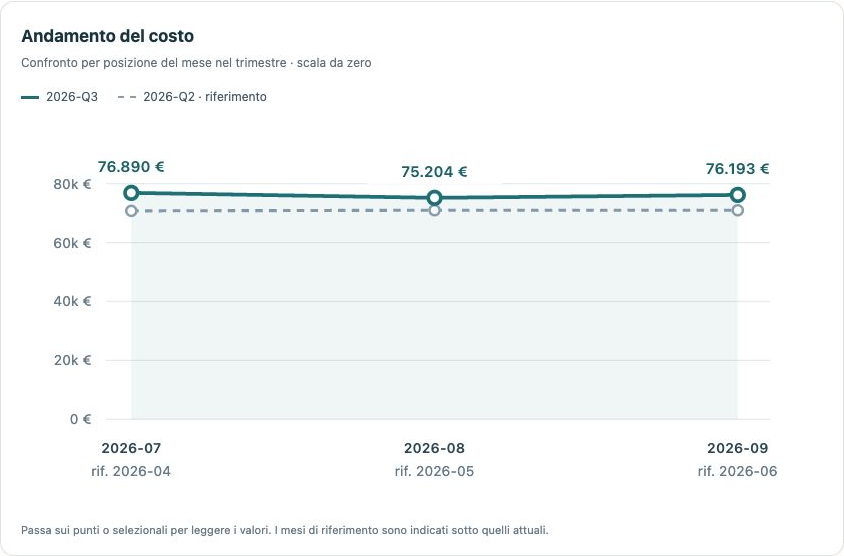

# ReportFlow — report trimestrali in lotto

Prototipo locale di automazione della reportistica per uno studio di consulenza del lavoro. Carica più export CSV, verifica la copertura dei trimestri, applica un modello comune e scarica PDF per azienda e riepiloghi CSV in un unico ZIP.

## Il caso concreto
**Sei export in due formati diventano tre report trimestrali e un riepilogo per lo studio, in un’unica elaborazione.**

Il problema affrontato è la preparazione ripetitiva dei report: uniformare colonne, verificare i mesi, calcolare gli indicatori e comporre i documenti per cliente. La demo usa dati sintetici; non misura un risparmio di tempo rispetto a un processo reale.

[Guarda il video illustrativo di 62 secondi](media/ReportFlow_Caso_Uso.mp4) · [Riproduci il caso passo per passo](docs/CASO_USO.md) · [Controlla i valori attesi](docs/risultati-attesi.json)

### Prova senza installare
Scarica il repository, estrai lo ZIP e apri `dist/ReportFlow_DEMO.html` nel browser. Per la prova più rapida usa il lotto dimostrativo già incluso nella pagina. I sei file originali sono anche nella cartella [examples](examples).

Il [pacchetto di risultati](docs/Esempio_Report_Trimestrali.zip) contiene tre PDF di tre pagine, riepilogo dello studio, reparti e copertura in CSV. Il video è una presentazione a schermate con didascalie, senza audio; non è una registrazione in tempo reale.

### Competenze mostrate
- Importazione CSV con formati numerici e intestazioni differenti.
- Normalizzazione dei dati, controlli sui duplicati e copertura temporale.
- Indicatori spiegabili e confronti tra periodi.
- Anteprima interattiva e generazione di PDF e ZIP nel browser.
- Verifiche riproducibili su dati sintetici.

## Avvio
Apri `dist/ReportFlow_DEMO.html` con doppio clic in un browser moderno. Premi **Prova con 6 export fittizi**, poi segui i quattro passaggi. Nessuna installazione, credenziale o connessione al gestionale richiesta.

## Differenza rispetto a Payroll Control
Il risultato è un pacchetto di report periodici per clienti: non una coda di anomalie o un controllo dei cedolini. Il progetto è autonomo e non comunica con Payroll Control.

## Dati e importazione
Sei export sintetici, aprile–settembre 2026, tre aziende, 319 record. Due tracciati dimostrativi con intestazioni e convenzioni numeriche diverse. Le colonne sconosciute possono essere associate manualmente; la mappatura confermata viene ricordata localmente, quando il browser lo consente.

Campi richiesti: azienda, mese, matricola, reparto, fte, ore_teoriche, ore_assenza, ore_straordinario, ferie_residue, lordo_corrente, contributi_azienda, quota_tfr, ratei_maturati. Un record per azienda/mese/matricola. Massimo 20 file, 3 MB per file, 5.000 righe per file, 15.000 record complessivi. CSV con separatore punto e virgola, virgola o tab.

Il costo somma lordo corrente, contributi azienda, TFR e ratei: le definizioni dell'export devono evitare duplicazioni. FTE medi: somma degli FTE mensili divisa per tre. Organico e ferie residue: ultimo mese del trimestre. Assenze: ore di assenza su ore teoriche. I mesi mancanti non valgono zero. Target incompleto: azienda esclusa; riferimento incompleto: confronto non disponibile. La presenza dei mesi non certifica la completezza degli export.

## Output
Tre pagine PDF per azienda; riepilogo dello studio, dettaglio reparti e copertura in CSV; note di utilizzo. I PDF sono generati nel browser; l'anteprima consente di cambiare misura e leggere i singoli mesi. I commenti sono deterministici e descrittivi, senza dedurre cause.

## Limiti
Solo dati fittizi nella demo. Nessuna compatibilità certificata con Zucchetti, TeamSystem o altri gestionali. Nessun accesso alle loro API. Nessun invio email. File in memoria, persi chiudendo la pagina. La distribuzione dell'HTML include il codice JavaScript leggibile. Non utilizzare come servizio paghe in produzione.

## Sviluppo e verifica
Node.js: `node build.cjs` ricostruisce l'HTML autonomo. `node verify.cjs` verifica importazioni, duplicati, copertura, indicatori e genera PDF/ZIP di prova in `qa/`. Nessuna dipendenza esterna JavaScript. Prima di pubblicare verificare che siano presenti esclusivamente dati sintetici.

Il report include costo trimestrale per FTE medio, variazione degli FTE medi e organico a fine periodo, tabella mensile di persone, FTE, straordinari e assenze. La variazione delle persone presenti non è un conteggio di assunzioni/cessazioni. Il costo per FTE usa la media non arrotondata; valori mostrati arrotondati.

I grafici interattivi SVG confrontano i mesi target con quelli del trimestre precedente (posizione del mese nel trimestre), con scale da zero, legenda e dettagli accessibili da tastiera. Nei PDF il confronto mensile usa colonne affiancate. `node tests/charts.test.cjs` verifica scale, assenza di riferimento e casi con valori zero.
